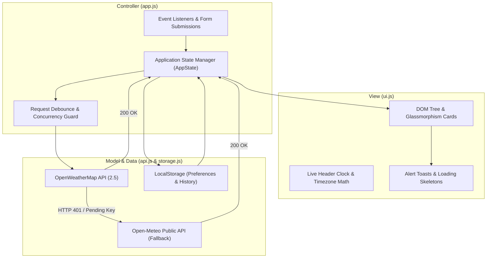

<div align="center">

# 🌤️ SkyCast — Modern Weather Forecast Application

**A production-ready, responsive weather intelligence dashboard built with pure HTML5, CSS3, and Vanilla JavaScript (ES6+).**

[](#)
[](#)
[](#)
[](#)
[](#)
[](#)

<p align="center">
  <a href="#-key-features">Features</a> •
  <a href="#-system-architecture">Architecture</a> •
  <a href="#-getting-started">Getting Started</a> •
  <a href="#-api-configuration--resilience">API Setup</a> •
  <a href="#-javascript-masterclass">JS Concepts</a> •
  <a href="#-project-structure">Folder Structure</a> •
  <a href="#-browser-compatibility">Compatibility</a>
</p>

</div>

---

## 📖 Executive Summary

**SkyCast** is an enterprise-grade weather forecasting web application engineered without external JavaScript frameworks (no React, Vue, or Angular) or third-party CSS libraries. It demonstrates modern front-end craftsmanship: dark-mode-first glassmorphism, fluid micro-interactions, dynamic condition-based atmospheric lighting, robust multi-provider API resilience, and timezone-accurate data visualization.

Beyond serving as an everyday weather dashboard, SkyCast is designed as an educational reference implementation for developers seeking to master **asynchronous JavaScript**, **HTTP lifecycle handling**, **event delegation**, **modular architecture**, and **defensive browser storage**.

---

## ✨ Key Features

### 1. Global Search & Smart Geolocation
- **Universal City Search**: Autocomplete-ready search query engine with `Enter` key listeners, clear (`×`) controls, and input validation with CSS shake animations.
- **Hardware GPS Geolocation**: Direct integration with the browser's `navigator.geolocation` API, returning real-time atmospheric metrics for the user's exact coordinates.
- **Client-Side Reverse Geocoding**: Automatically resolves GPS coordinates into recognized city and country names.
- **Quick-Access World Capitals**: One-click quick search pills for major hubs (*London, New York, Tokyo, Paris, Sydney, Dubai*).
- **Persistent Search History**: Tracks recently queried locations in browser `localStorage` with individual deletion and click-to-search functionality.

### 2. Live Atmospheric Metrics
- **Timezone Synchronization**: Computes the exact local date and clock time of the queried city using UTC offsets (`data.timezone`), unaffected by the client machine's local timezone.
- **Dynamic Ambient Color Engine**: Background ambient gradients adapt to current weather conditions (solar amber for clear skies, slate violet for thunderstorms, oceanic azure for rain, frosty cyan for snow).
- **7 Dedicated Atmospheric Cards**:
  1. **Relative Humidity (%)**: Moisture index with qualitative comfort indicators (*Dry, Comfortable, High Moisture*).
  2. **Wind Velocity & Direction**: Real-time speed formatted in `km/h` or `mph` alongside a 16-point meteorological compass bearing (e.g., `NE 45°`).
  3. **Barometric Pressure**: Atmospheric pressure in `hPa` with fair/stormy threshold classification.
  4. **Visibility Range**: Distance ratings in kilometers or miles with optical clarity descriptions.
  5. **Cloud Coverage**: Cloud cover percentage with an animated visual gauge meter.
  6. **Solar Sunrise**: Calculated dawn timestamp adjusted to the city's local time.
  7. **Solar Sunset**: Calculated dusk timestamp adjusted to the city's local time.

### 3. Predictive Forecasts
- **24-Hour Hourly Timeline**: Horizontally scrollable 3-hour interval cards with responsive navigation controls, displaying temperatures, weather icons, and Probability of Precipitation (`POP %`).
- **5-Day Extended Outlook**: Daily forecast summaries with diurnal min/max temperatures, midday condition icons, and an Apple Weather-inspired proportional gradient temperature range bar.

### 4. User Experience & Customization
- **Instant Unit Toggle (°C / °F)**: Effortlessly switch between Metric and Imperial measurement standards with instantaneous UI recalculation and persistent memory.
- **Dual Theme Switcher**: Toggle between an immersive **Midnight Navy Glass** theme and a crisp **Airy Light Sky** theme with SVG icon morphing.
- **Request Debounce & Concurrency Locking**: Prevents duplicate in-flight network requests on rapid clicks or repeated `Enter` keystrokes.
- **In-App API Key Manager**: Built-in modal dialog featuring a real-time key diagnostic validator, password visibility toggle, and secure local storage.

---

## 🏛️ System Architecture

SkyCast strictly follows the **Model-View-Controller (MVC)** architectural pattern to maintain clean separation of concerns and modular maintainability:



### Module Responsibilities

| File | Architectural Role | Core Responsibilities |
| :--- | :--- | :--- |
| [`js/config.js`](file:///c:/Users/user/Desktop/Weather/js/config.js) | Configuration | API endpoint definitions, default city/unit presets, and metadata. |
| [`js/storage.js`](file:///c:/Users/user/Desktop/Weather/js/storage.js) | Data Persistence | Browser `localStorage` CRUD operations for search history, units, theme, and API keys. |
| [`js/api.js`](file:///c:/Users/user/Desktop/Weather/js/api.js) | Network Model | Fetch API requests, OpenWeatherMap integration, Open-Meteo fallback, and error handling. |
| [`js/ui.js`](file:///c:/Users/user/Desktop/Weather/js/ui.js) | Presentation View | DOM selection, HTML template generation, timezone calculation, and UI animations. |
| [`js/app.js`](file:///c:/Users/user/Desktop/Weather/js/app.js) | Application Controller | State orchestration, event delegation, lifecycle startup, and user interaction binding. |

---

## 🌐 API Configuration & Resilience

SkyCast includes built-in **dual-provider resilience** to ensure users are never blocked by API rate limits, downtime, or key activation delays.

```
                  ┌────────────────────────┐
                  │ User Initiates Search  │
                  └───────────┬────────────┘
                              │
                    Has Custom API Key?
                   /                  \
             YES  /                    \  NO
                 ▼                      ▼
    ┌─────────────────────────┐   ┌─────────────────────────┐
    │  Query OpenWeatherMap   │   │ Query Open-Meteo Public │
    └────────────┬────────────┘   │ (Instant Live Worldwide)│
                 │                └─────────────┬───────────┘
          Response Status?                      │
         /        │       \                     │
     200 OK    401/429    Network Error         │
       │          │             │               │
       ▼          ▼             ▼               │
    Render     Fallback to   Display Offline    │
    Results    Open-Meteo    Toast Message      │
                  │                             │
                  └──────────────┬──────────────┘
                                 ▼
                     Render Live Weather Data
```

### Option 1: Zero-Configuration Mode (Instant Live Weather)
SkyCast works **out of the box** without any setup required. If no custom key is provided, or if a newly generated key is still propagating, the app automatically pulls real-time weather from the open [Open-Meteo](https://open-meteo.com/) API.

### Option 2: OpenWeatherMap API Integration
To connect directly to your personal OpenWeatherMap developer account:

1. **Obtain a Free Key**:
   - Register at [home.openweathermap.org/users/sign_up](https://home.openweathermap.org/users/sign_up).
   - Confirm your email address (required by OpenWeatherMap to activate keys).
   - Copy your 32-character key from your account dashboard under **API keys**.

2. **Configure Your Key (Choose Either Method)**:
   - **Method A (Web UI)**: Click the **Key Settings** icon in the navigation bar, paste your key, and click **Save & Connect**.
   - **Method B (Code File)**: Open [`js/config.js`](file:///c:/Users/user/Desktop/Weather/js/config.js) and insert your key:
     ```javascript
     const CONFIG = {
       API_KEY: 'your_32_character_api_key_here',
       BASE_URL: 'https://api.openweathermap.org/data/2.5',
       DEFAULT_CITY: 'London',
       DEFAULT_UNIT: 'metric'
     };
     ```

### Troubleshooting HTTP Error Codes

| HTTP Status | Root Cause | Built-in SkyCast Resolution |
| :---: | :--- | :--- |
| **`401`** | New OpenWeatherMap keys take **10 to 30 minutes** to propagate across edge servers, or email is unconfirmed. | SkyCast alerts you of the propagation window and seamlessly serves live data via the public API fallback. |
| **`404`** | City name was misspelled or unrecognized. | Displays a dismissible error toast prompting the user to verify the spelling. |
| **`429`** | OpenWeatherMap rate limit exceeded (60 calls/minute on free tier). | Notifies the user and routes secondary requests through the open fallback gateway. |
| **`Offline`** | Client internet disconnect or DNS resolution failure. | Triggers an offline notification: *"Unable to connect. Please check your internet connection."* |

---

## 🚀 Getting Started

Because SkyCast uses native ES6+ JavaScript without build tools or bundlers, it can be launched in seconds:

### Quick Launch Options

#### Option A: Direct Browser Execution
Navigate to the project root and double-click [`index.html`](file:///c:/Users/user/Desktop/Weather/index.html) (or right-click and choose your preferred browser).

#### Option B: VS Code / Antigravity Live Server
1. Open the project directory in VS Code or Antigravity.
2. Ensure the **Live Server** extension is installed.
3. Right-click on `index.html` and click **"Open with Live Server"**.
4. The application will be accessible at `http://127.0.0.1:5500/index.html`.

#### Option C: Python HTTP Server (Command Line)
Run a local lightweight server using Python:
```bash
# Python 3.x
python -m http.server 3000
```
Open `http://localhost:3000` in your web browser.

#### Option D: Node.js / npx serve
```bash
npx serve .
```

---

## 🧠 JavaScript Masterclass: Core Concepts

This application was engineered to demonstrate clean, idiomatic JavaScript principles. Key patterns in the codebase include:

### 1. Concurrent Parallel Requests with `Promise.all`
Instead of sequentially awaiting the current weather endpoint and then the forecast endpoint (which doubles network latency), SkyCast dispatches both HTTP requests concurrently:

```javascript
// js/api.js
async searchWeather(city, unit = 'metric') {
  // Dispatches both requests simultaneously
  const [currentData, forecastData] = await Promise.all([
    this.fetchCurrentWeather(city, unit),
    this.fetchForecast(city, unit)
  ]);

  return { current: currentData, forecast: forecastData };
}
```

### 2. Timezone-Independent Local Time Calculation
JavaScript's `Date` object defaults to the user's local operating system timezone. To render the exact local time in Tokyo while a user views the site from New York, SkyCast shifts UTC timestamps by the city's timezone offset and formats using `timeZone: 'UTC'`:

```javascript
// js/ui.js
getCityLocalDateTime(timezoneOffsetSeconds = 0) {
  // Epoch ms shifted by the target city's UTC offset
  const cityNowMs = Date.now() + (timezoneOffsetSeconds * 1000);
  const cityDate = new Date(cityNowMs);

  return {
    formattedTime: cityDate.toLocaleTimeString('en-US', {
      timeZone: 'UTC',
      hour: 'numeric',
      minute: '2-digit',
      hour12: true
    }),
    formattedDate: cityDate.toLocaleDateString('en-US', {
      timeZone: 'UTC',
      weekday: 'long',
      month: 'short',
      day: 'numeric'
    })
  };
}
```

### 3. Defensive LocalStorage Serialization & Storage Quota Protection
To guard against private browsing restrictions, storage exhaustion, or corrupted JSON strings, all storage methods are safely wrapped:

```javascript
// js/storage.js
saveRecentSearch(city) {
  try {
    const existing = this.loadRecentSearches();
    // Case-insensitive deduplication
    const filtered = existing.filter(
      item => item.toLowerCase() !== city.trim().toLowerCase()
    );
    filtered.unshift(city.trim());

    const trimmed = filtered.slice(0, this.MAX_RECENT_SEARCHES);
    localStorage.setItem(this.KEYS.RECENT_SEARCHES, JSON.stringify(trimmed));
    return trimmed;
  } catch (error) {
    console.warn('Storage operation failed safely:', error);
    return [];
  }
}
```

### 4. DOM XSS Prevention
User-supplied input and API response strings are inserted using `element.textContent` rather than `innerHTML` wherever dynamic text is rendered, neutralizing Cross-Site Scripting (XSS) vectors.

---

## 📁 Project Structure

```
weather-app/
│
├── index.html                  # Semantic HTML5 markup, ARIA roles, and component containers
│
├── css/
│   └── style.css               # Design tokens, CSS variables, glassmorphism, responsive grids
│
├── js/
│   ├── app.js                  # Application state, orchestration, lifecycle, and event listeners
│   ├── api.js                  # Fetch API client, OpenWeatherMap & Open-Meteo dual-engine
│   ├── ui.js                   # DOM manipulation, card rendering, and timezone formatting
│   ├── storage.js              # LocalStorage CRUD interface with defensive error handling
│   ├── config.js               # Active runtime configuration file
│   └── config.example.js       # Template configuration with educational security notes
│
├── assets/
│   ├── icons/                  # Scalable SVG weather and metric icons
│   │   ├── clear-day.svg       # Sunny / clear sky day icon
│   │   ├── clear-night.svg     # Moon / clear sky night icon
│   │   ├── partly-cloudy.svg   # Scattered clouds icon
│   │   ├── cloudy.svg          # Overcast clouds icon
│   │   ├── rain.svg            # Rain showers icon
│   │   ├── thunderstorm.svg    # Thunderstorm with lightning icon
│   │   ├── snow.svg            # Snow flurries icon
│   │   ├── mist.svg            # Atmospheric fog/haze icon
│   │   ├── humidity.svg        # Water droplet humidity metric icon
│   │   ├── wind.svg            # Wind flow metric icon
│   │   ├── pressure.svg        # Barometer pressure dial icon
│   │   ├── visibility.svg      # Eye visibility metric icon
│   │   ├── sunrise.svg         # Solar sunrise icon
│   │   └── sunset.svg          # Solar sunset icon
│   └── images/                 # Image assets directory
│
└── README.md                   # Project documentation and architectural blueprint
```

---

## 📱 Browser Compatibility

SkyCast is engineered to operate seamlessly across all modern evergreen desktop and mobile browsers:

| Browser | Desktop Support | Mobile Support | Tested Features |
| :--- | :---: | :---: | :--- |
| **Google Chrome** | ✅ v88+ | ✅ Android | Fetch, CSS Backdrop-Filter, Geolocation, Grid |
| **Mozilla Firefox** | ✅ v85+ | ✅ Android | CSS Custom Properties, LocalStorage, Flexbox |
| **Apple Safari** | ✅ v14+ | ✅ iOS | Touch Scrolling, Backdrop Blur, Web APIs |
| **Microsoft Edge** | ✅ v88+ | ✅ Windows/Android | Chromium Engine Standards, SVG Scaling |
| **Opera / Brave** | ✅ Latest | ✅ Mobile | Privacy Mode Compatibility, Ad-block Tolerance |

---

## 🔒 Security Best Practices for Frontend APIs

When deploying client-side web applications:

> **Important:** Any API key embedded in front-end HTML, CSS, or JavaScript files is publicly visible to anyone inspecting network traffic or source code (`DevTools -> Network`).
> - For personal projects and educational portfolios, OpenWeatherMap's free tier is standard and safe to use.
> - For production enterprise deployments, requests should be routed through a backend proxy server (such as Node.js/Express, Python/FastAPI, or a serverless cloud function) to keep commercial API secrets secured server-side.

---

## 📄 License

This project is licensed under the **MIT License** — you are free to use, modify, and distribute this software for personal and commercial applications. See the LICENSE file for details.

<div align="center">
  <sub>Crafted with modern Vanilla JavaScript, CSS3 &amp; HTML5. Powered by OpenWeatherMap and Open-Meteo APIs.</sub>
</div>
